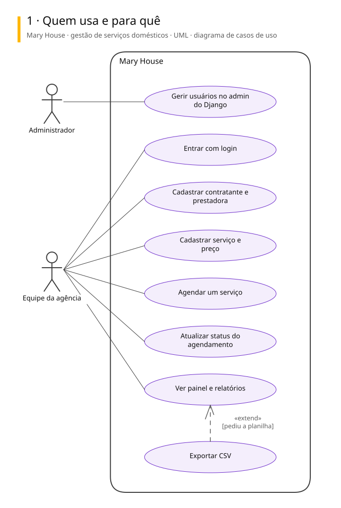
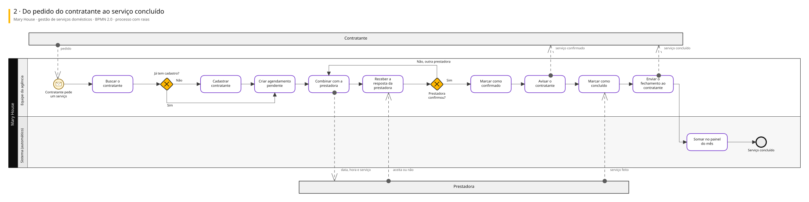
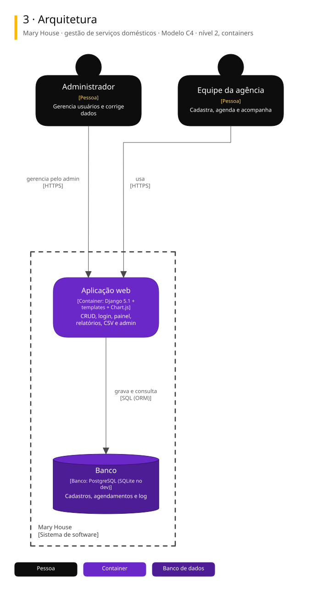

# Arquitetura

Três vistas do sistema, cada uma numa notação padrão.

| Vista | Notação | Responde |
|---|---|---|
| 1. Casos de uso | UML | Quem usa e para quê |
| 2. Processo | BPMN 2.0 | Como o trabalho anda, com uma raia para cada quem executa |
| 3. Arquitetura | C4, nível 2 | De que partes o sistema é feito e com quem conversa |

## Mary House · gestão de serviços domésticos

Sistema interno em Django da agência Mary House: cadastra contratantes, prestadoras e serviços, amarra tudo num agendamento com status e mostra painel, relatórios e histórico. Encerrado em 03/09/2026; a proposta de levar para Worker não foi adiante.

### 1. Quem usa e para quê

### 2. Do pedido do contratante ao serviço concluído

### 3. Arquitetura

Para editar: [mary-house.excalidraw](./mary-house.excalidraw), que abre em [excalidraw.com](https://excalidraw.com) ou na extensão Excalidraw do VS Code.

## De onde vêm

Os diagramas são gerados a partir do Sinapse, o vault onde o Pedro organiza notas e projetos. Mudança feita direto aqui some na próxima publicação: o lugar de mudar é a especificação no Sinapse.
